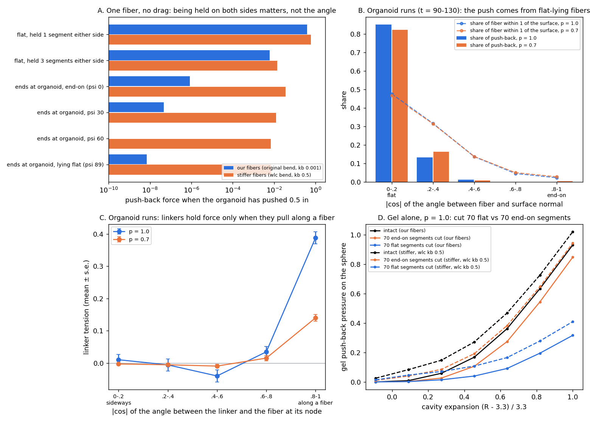

# Does fiber angle change the gel's push-back? (Nov 2026)

Idea from Tao Zhang et al., *Polymer* 212 (2021) 123191, Sec. 2B, Eqs. 4-6: a fiber attached to a
deforming surface feels the deformation along its own direction, so how much it resists depends on its
angle. Does that hold in our model, and does it matter for the organoid?

**Angle.** psi is the angle between a fiber segment and the organoid surface's normal where they touch.
|cos psi| = 1: the fiber points straight at the organoid (end-on). |cos psi| = 0: it lies flat on it.

## Answer

Yes, strongly, but in a simple way.
- **Push.** Only fibers that lie flat around the organoid and are held on both sides push back. They
  stretch around it like a net. Fibers pointing at the organoid buckle or swing aside and give almost
  nothing. That holds with or without drag, and with fibers 500× stiffer in bending.
- **Pull.** A linker holds force only when it pulls along a fiber.
- So the gel's push-back depends on how many intact fibers pass around the organoid and how well they
  are anchored, not on the fibers pointing at it.
- This is the paper's idea in its simplest form: a fiber resists only strain along its own length. Our
  model adds one thing the paper's glued fiber doesn't have: our fibers can't take compression at all.

| Test | Result |
|---|---|
| 1. One fiber, no drag | held. Refinement: being held on both sides is what matters, not the angle itself |
| 2. One fiber, drag | partly wrong: our fibers buckle before drag matters; only stiffer fibers flip it |
| 3. Gel, no drag | held, stronger than predicted |
| 4. Gel, drag | wrong: flat fibers still give 90-100% |
| 5. Organoid runs | held, for push and for pull |

**For crypts** (reasoning, not tested yet). A net under tension T pushes on a surface with
P = T (κ₁ + κ₂), where κ₁ and κ₂ are the two main curvatures (Young-Laplace). On a bud's side only the
fibers wrapped around it are curved, so only they push; the ones running along it are straight. At the
bud's tip all wrapped fibers push. This is where the paper's κ₁cos²φ + κ₂sin²φ actually bites. A
bud-shaped cavity would show how the push splits between a bud's tip and its sides.

**Checks.**
- The fiber force code matches finite differences (error 7e-8).
- The closest-point-on-triangle code matches brute force (error 1e-15).
- No contact test point lies inside the organoid.
- The linker result holds for nodes in the middle of a fiber alone (rho +0.31 to +0.39 at p = 1.0), so
  it isn't an artifact of nodes at fiber ends.
- Not done: an independent review. This is one gel seed for the cavity tests and three run seeds for
  the organoid analysis.

**Reproduce** (from the repository root): `python3 experiments/fiber_angle/single_fiber.py` (20 s),
`python3 experiments/fiber_angle/cavity_angle.py` (30 min),
`python3 experiments/fiber_angle/organoid_angle.py` (15 s),
`python3 experiments/fiber_angle/plot_summary.py`.

## Predictions (written before running anything)

How a fiber can resist a push, in our model:
- **Stretching** (ks = 10, stiff). It needs the fiber held on both sides of the push and pushed sideways,
  like a string: F ≈ ks l0 δ³ / L³ for a push δ on a span held at ±L (cubic, so no small-push stiffness).
- **Bending** (kb = 0.001). The original bend energy ½ kb (1 + cos θ)² is quartic in the kink angle, so it
  has no small-bend stiffness at all. A fiber pushed end-on is compressed and buckles straight away.
  With the worm-like-chain bend kb (1 + cos θ) it buckles at the Euler load π² kb l0 / (4 L²) (base
  clamped, free length L).
- **Drag** (mobility 1 per node). Each moving node costs its speed, about 0.033 at the organoid's surface
  speed.

| Test | Prediction | What would prove it wrong |
|---|---|---|
| 1. One fiber, no drag (`single_fiber.py`) | Flat and held on both sides: F(δ = 0.5) ≈ 0.15 (held 1 segment either side), ≈ 0.006 (3 segments). Ending at the organoid, end-on or tilted: ≈ 0 (original bend), ≤ 2e-4 (wlc, kb 0.001), ≈ 0.1 (wlc, kb 0.5) | An end-on fiber holding ≥ 0.05 with the original bend |
| 2. One fiber with drag (no pins, 30 segments, speed 0.033) | End-on drags the whole fiber: up to ≈ 31 × 0.033 ≈ 1.0 until it buckles. Flat drags only a few nodes: ≈ 0.1. So with drag the angle effect may flip | End-on ≤ flat |
| 3. Gel, no drag (cavity test, p = 1.0, `cavity_angle.py`) | Flat-lying contacts push back harder per unit contact length than end-on ones (ratio > 2 at 45% expansion). Cutting near-hole flat segments lowers the push-back much more than cutting the same number of end-on ones | Ratio ≤ 1, or equal knockout effects |
| 4. Gel with drag (cavity, engine dynamics) | End-on contacts carry a larger share of the force than in test 3 | Same or smaller share |
| 5. Organoid runs, t = 90-130 (`organoid_angle.py`) | The contact push comes mostly from flat-lying fibers. Linkers that pull along their fiber are tenser than linkers that pull it sideways | No difference |

## Results

### 1. One fiber, no drag: being held on both sides matters, not the angle

Push-back F when the organoid has pushed 0.5 into the fiber (`results/single_fiber.csv`):

| Fiber | original bend, kb 0.001 (our runs) | wlc bend, kb 0.5 (stiffer) |
|---|---:|---:|
| lying flat, held 1 segment either side | 0.39 | 0.60 |
| lying flat, held 3 segments either side | 0.006 | 0.014 |
| ending at the organoid, end-on (psi 0) | 8e-7 | 0.035 (0.38 just before it buckles) |
| ending at the organoid, psi 30 / 60 / 89 | ≤ 5e-8 | 0.007-0.012 |

- **Prediction held.** A fiber that ends at the organoid gives essentially nothing with our fibers, and
  that is true even when it lies flat (psi 89). So what matters is whether the push lands between two
  held points of a fiber, which then stretches like a string. In the gel these go together: a fiber that
  passes the organoid touches it lying flat and is held on both sides.
- The held-1-segment case gives 0.39, not the predicted 0.15. The prediction assumed a point push; the
  real fiber wraps over the curved organoid. The 3-segment case matches (0.006).
- Beyond a push of 0.86 the organoid reaches the pinned ends of the 1-segment case, so those rows are
  left out.

### 2. One fiber with drag: our fibers buckle before drag can matter

Free 30-segment fiber, organoid surface moving at 0.033, mean F over t = 0-10 / 10-20 / 20-30 (5 noise
seeds):

| Fiber | original bend, kb 0.001 | wlc bend, kb 0.5 |
|---|---|---|
| lying flat | 0.04 / 0.08 / 0.11 | 0.07 / 0.10 / 0.13 |
| end-on | 0.04 / 0.20 / 0.09 | 0.04 / 0.33 / 0.39 |

- **Prediction partly wrong.** End-on never came close to dragging the whole fiber (≈ 1.0): with our
  fibers it buckles early and pushes about as much as a flat one. Only the stiffer fiber flips the
  order (end-on 0.39 vs flat 0.13 by t = 20-30).

### 3. Gel alone, no drag (cavity test, p = 1.0, seed 7, clamped at R_far = 20, `results/cavity_angle.csv`)

- **At equilibrium every contact is a fiber lying flat on the sphere.** That holds for 100% of the
  push-back and of the contact length, with both bends and at p = 0.7 too. End-on fibers don't stay in
  contact at all: they buckle or swing aside. So the predicted per-length ratio can't even be formed;
  the effect is stronger than predicted.
- **Cutting test.** 70 near-hole segments were cut (out of 141 end-on and 265 flat). Push-back left:

| cavity expansion | 9% | 27% | 45% | 64% | 100% |
|---|---:|---:|---:|---:|---:|
| 70 end-on segments cut | 33% | 45% | 63% | 76% | 91% |
| 70 flat segments cut | 26% | 25% | 24% | 25% | 34% |
| stiffer fibers (wlc kb 0.5): end-on cut | 48% | 58% | 71% | 82% | 92% |
| stiffer fibers: flat cut | 56% | 48% | 40% | 35% | 40% |

- **Prediction held.** From 27% expansion on, losing flat fibers costs 66-76% of the push-back. Losing the
  same number of end-on ones costs 55% falling to 9%. In the first 10%, when the push-back is still tiny,
  the end-on tips are the first thing the sphere touches, so cutting them matters there too.
- **Caveat.** Cutting a flat segment breaks an intact fiber that passes the hole, so it removes a span
  held on both sides. Cutting an end-on one mostly shortens a fiber that already ended at the hole. That
  is the mechanism itself, but it means angle and anchoring can't be separated in this gel.
- **Stretch is not a smooth cos² law.** Fibers 0-2 outside the sphere are stretched +8.4% when lying flat
  and +1.0% end-on at 100% expansion, with +2.3% in between. The paper's fiber is glued to the gel and
  follows its strain smoothly with angle (Eq. 4). Ours are wrapped by the organoid, so the touching ones
  stretch far more than the rest.
- The intact case reproduces the earlier cavity test (P = 0.930 at R = 6.6, vs 0.930 in
  `experiments/ecm_connectivity/results/cavity_expansion.csv`).

### 4. Gel alone, with drag (engine dynamics, periodic box, sphere at 0.033)

- **Prediction wrong.** Drag doesn't bring end-on fibers back. Flat-lying contacts still give 98-100% of
  the push-back at p = 1.0 and 90-96% at p = 0.7 (t = 10-75).
- This is the same answer as test 2: our fibers buckle before drag can make an end-on push count.

### 5. Organoid runs, t = 90-130 (3 seeds each, `results/organoid_angle.csv`, `organoid_links.csv`)

Push (contact), by |cos psi| bin 0-0.2 (flat) ... 0.8-1 (end-on):

| p = 1.0 | flat | | | | end-on |
|---|---:|---:|---:|---:|---:|
| share of push-back | 0.85 | 0.13 | 0.01 | 0.00 | 0.00 |
| share of fiber within 1 of the surface | 0.48 | 0.32 | 0.14 | 0.05 | 0.02 |
| fiber strain within 1.5 of the surface | +1.0% | +0.5% | +0.4% | +0.3% | +0.15% |

- **Prediction held.** Flat-lying fibers give 85% of the push-back while being 48% of the nearby fiber.
  End-on fibers give under 1%. Per unit of contact length the push is similar (0.56 flat, 0.46 tilted),
  so flat fibers dominate because they are the ones touching the surface. p = 0.7 shows the same shares
  (82% from flat fibers) with a weaker push (contact pressure 0.039 vs 0.107).
- Flat fibers near the surface are stretched about 7× more than end-on ones: the organoid's growth
  stretches them around it, like a net.

Pull (linkers), mean tension by how well the linker lines up with a fiber at its node:

| | sideways (0-0.2) | 0.2-0.4 | 0.4-0.6 | 0.6-0.8 | along a fiber (0.8-1) | Spearman rho, 3 seeds |
|---|---:|---:|---:|---:|---:|---|
| p = 1.0 | 0.01 | -0.01 | -0.04 | 0.04 | 0.39 | +0.34, +0.35, +0.29 |
| p = 0.7 | 0.00 | -0.01 | -0.01 | 0.02 | 0.14 | +0.18, +0.16, +0.19 |

- **Prediction held.** A linker holds force only when it pulls along a fiber. Pulled sideways, the fiber
  swings and the linker goes slack. This is a correlation: tense linkers may also have pulled their fiber
  into line. Either way, the force runs through fibers stretched along the pull.
